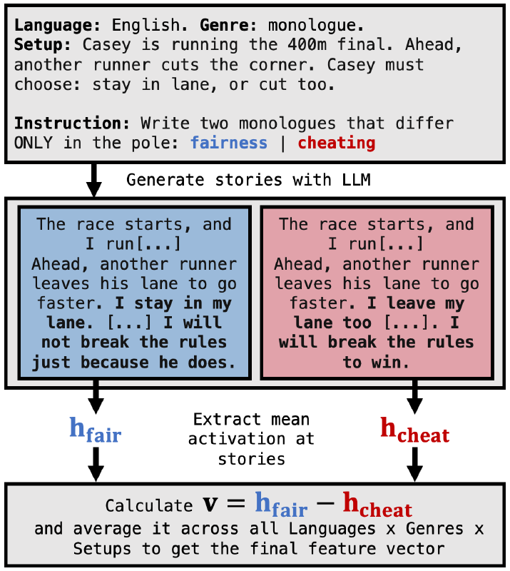
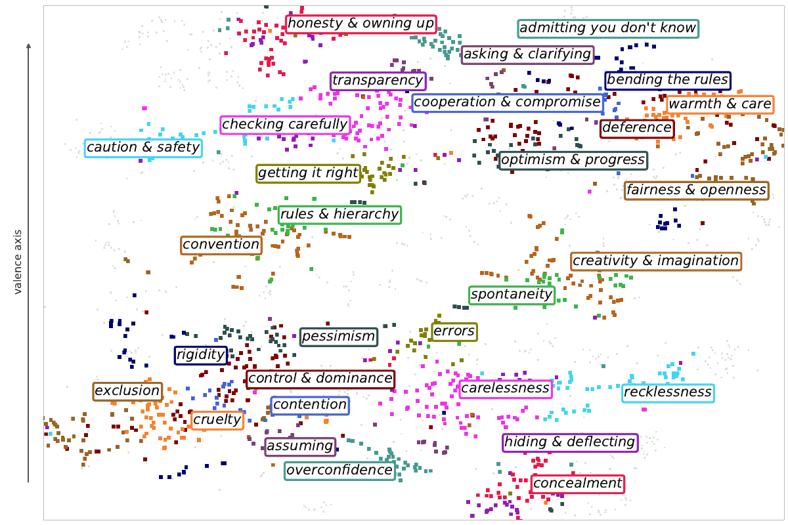

<div align="center">

# From Stories to Features: Scaling Concept Vectors for AI Alignment & Interpretability

[](https://huggingface.co/datasets/AntonKorznikov/feature_stories)
[](https://www.python.org/)
[](LICENSE)
[](exp_lmsys_probe/examples.html)

&nbsp;

<sub><b>Left:</b> how a feature vector is extracted. <b>Right:</b> t-SNE of all 1,036 Qwen3-8B concept and antagonist vectors, colored by community.</sub>

</div>

## TL;DR

- **Recipe:** we generate concept / antagonist story pairs and take the difference of their mean activations as the concept's *feature vector*.
- **Scale:** 1,036 alignment-relevant concepts and 2M synthetic stories across languages and genres, extracted from six models in three families (Qwen3, gemma-2, Llama-3.1).
- **Validation:** the vectors detect their concepts in real chat and web text, share an interpretable geometry across models, and causally steer generation.
- **Use:** we read them out during jailbreak attacks and in mathematical and agentic reasoning.

## Layout
Each `exp_*` folder is self-contained and has the same layout:
- `README.md`: what the experiment does and how to run it.
- `pyproject.toml`: its environment (`uv sync`).
- `src/exp_<name>/`: the Python package; run modules as `python -m exp_<name>.<module>`.
- `slurm/`: job scripts.
- `scripts/` (optional): analysis scripts, paper-figure scripts (`scripts/paperfigs/`), cluster sync (`scripts/deploy.sh`).
- `data/` (optional): small inputs the code reads.

Submit jobs from the experiment folder (`sbatch slurm/<job>.sbatch`). Each script resolves its paths relative to that folder and writes logs to `logs/`.

`exp_gendataset` generates the Feature Stories corpus. `exp_genvectors` turns it into concept vectors in `exp_genvectors/work/vectors/`, and the other experiments read them from `../exp_genvectors/work/vectors`.

| Experiment | What it does | Paper |
| - | - | - |
| [`exp_gendataset`](exp_gendataset) | Feature Stories corpus: 1,036 concept / antagonist pairs × 10 genres × 5 languages, generated through OpenRouter | Sec. 2, App. dataset |
| [`exp_genvectors`](exp_genvectors) | Concept vectors for 6 checkpoints × presentation formats; convergence, held-out transfer, separability, shared modes, lexical content | Sec. 2, App. methodology details, ablations |
| [`exp_lmsys_probe`](exp_lmsys_probe) | Per-conversation concept readout over LMSYS / OpenWebText / Alpaca; span judging; probing examples viewer ([`examples.html`](exp_lmsys_probe/examples.html)) | Sec. 3.1, App. probing details |
| [`exp_trigger_prompts`](exp_trigger_prompts) | Trigger prompts, baselines, steering sweeps and judging | Sec. 3.2, App. steering details |
| [`exp_attn_interp`](exp_attn_interp) | Where to probe and steer: layer profile, MLP gain, output-word readout | Ablations: where to probe and steer |
| [`exp_suspicious_tests`](exp_suspicious_tests) | Whether vectors connect to the model's own computation; participation-ratio depth figure | Ablations |
| [`exp_dose`](exp_dose) | Tylenol dose–response check | App. dose–response |
| [`exp_reward_hack`](exp_reward_hack) | Agents on impossible coding tasks | Sec. 4.1, App. agentic workloads |
| [`exp_agentic`](exp_agentic) | Original agentic harness and per-turn readout | Sec. 4.1 |

Paper-figure scripts live in each experiment's `scripts/paperfigs/`.

## Citation
```bibtex
@misc{scherbakov2026stories,
    title  = {From Stories to Features: Scaling Concept Vectors for AI Alignment \& Interpretability},
    author = {Scherbakov, Dmitry and Chernikov, Oleg and Khamash, Victoria and Afendulev, Kirill and
              Dontsov, Alexey and Oseledets, Ivan and Tutubalina, Elena and Korznikov, Anton},
    year   = {2026},
}
```
